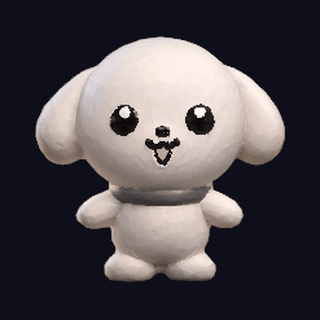
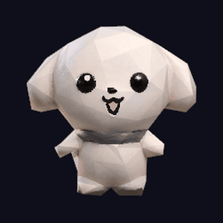
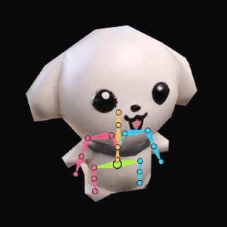
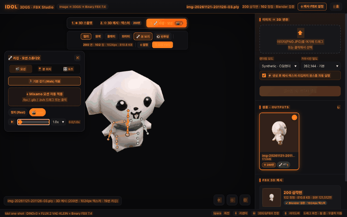

<div align="center">

<a href="https://mjudcd.com">
  
</a>

<h1>dcd-img2rig</h1>

<p>
  <strong>이미지 한 장으로 게임용 리깅 FBX까지 한 번에</strong><br/>
  <a href="https://mjudcd.com">명지대학교 디지털콘텐츠디자인학과(DCD)</a> 학생들의 게임 제작을 위한 3D 에셋 생성 &amp; 자동 리깅 스튜디오
</p>

<p align="center">
  <a href="https://mjudcd.com"></a>
  <a href="https://huggingface.co/speridlabs/idol"></a>
  <a href="https://www.python.org/"></a>
  <a href="https://www.blender.org/download/"></a>
  <a href="LICENSE"></a>
</p>

[AI 자동 세팅](#-ai-에이전트로-1분-만에-세팅하기) · [파이프라인 & Idol](#-파이프라인--기반-모델) · [시스템 요구 사항](#-시스템-요구-사항) · [설치 및 실행](#-설치-및-실행) · [CLI & 레퍼런스](#-cli-사용법) · [라이선스](#-저작권-및-라이선스)

</div>

---

<table>
  <tr>
    <td align="center" width="20%">
      <br/>
      <sub><b>1. 입력 이미지</b><br/>단일 캐릭터 PNG</sub>
    </td>
    <td align="center" width="20%">
      <br/>
      <sub><b>2. 3DGS (.ply)</b><br/>Idol 360° 스플랫</sub>
    </td>
    <td align="center" width="20%">
      <br/>
      <sub><b>3. 메시 3,000면 (.fbx)</b><br/>부드러운 미드폴리</sub>
    </td>
    <td align="center" width="20%">
      <br/>
      <sub><b>4. 메시 200면 (.fbx)</b><br/>경량 로우폴리 조절</sub>
    </td>
    <td align="center" width="20%">
      <br/>
      <sub><b>5. 19본 리깅 &amp; Walk</b><br/>스켈레톤 · 모션 적용</sub>
    </td>
  </tr>
</table>

<p align="center">
  <sub>
    <b>생성 환경 및 실측 소요 시간</b> · MacBook Pro (<b>Apple M5 Pro</b> · 15-core · <b>24 GB</b> 통합 메모리 · macOS MPS)<br/>
    3DGS 생성 (262,144개 · 50 steps): <b>약 3분 48초</b> (227.5s) · 메시/FBX + UV + 19본 리깅: <b>4.7s</b> (200면) / <b>5.7s</b> (3,000면) · 모션 리타게팅: <b>~1s</b>
  </sub>
</p>

---

## 🤖 AI 에이전트로 1분 만에 세팅하기

터미널 설정이 익숙하지 않다면 **Claude Code · Codex · Antigravity · Cursor** 등 사용 중인 AI 코딩 에이전트에게 아래 프롬프트를 그대로 복사해 전달하세요.

```text
https://github.com/sevendays52/dcd-img2rig

이 저장소를 내 컴퓨터 환경(OS/GPU 확인 포함)에서 바로 사용할 수 있도록 세팅해줘.
1. 저장소를 클론하거나 현재 폴더 기준으로 Python 3.10~3.12 가상환경(.venv)을 만들고,
   NVIDIA CUDA 환경이면 CUDA용 PyTorch를 먼저 설치한 뒤 `pip install -e ".[dev]"`로 설치해줘.
2. Blender 경로(BLENDER_BIN)를 확인하고 `outputs/`, `uploads/` 폴더를 준비해줘.
3. `pytest`로 기본 테스트 통과를 확인하고, Hugging Face 로그인이 필요하면 안내해줘.
4. 마지막으로 웹 스튜디오(`dcd-img2rig`) 실행 명령어와 접속 주소를 알려줘.
```

> [!IMPORTANT]
> **사용자가 직접 해야 하는 1가지: Hugging Face 모델 약관 동의**
> 3D 생성 모델([Idol](https://huggingface.co/speridlabs/idol))이 사용하는 아래 2개 페이지에 로그인해 **Agree / Access**를 승인한 뒤, AI가 안내할 때 `hf auth login` 또는 `HF_TOKEN`만 입력하면 됩니다.
> - [`facebook/dinov3-vith16plus-pretrain-lvd1689m`](https://huggingface.co/facebook/dinov3-vith16plus-pretrain-lvd1689m) · [`black-forest-labs/FLUX.2-dev`](https://huggingface.co/black-forest-labs/FLUX.2-dev)

---

## ⚡ 파이프라인 & 기반 모델

단일 캐릭터·오브젝트 이미지에서 **3DGS 생성 → 메시/텍스처 변환 → Binary FBX 7.4 → 19본 자동 리깅 → Mixamo 모션 적용**까지 하나의 웹 스튜디오와 CLI로 처리합니다.

| 단계 | 입력 → 출력 | 핵심 기술 |
|---|---|---|
| **1. 3DGS 생성** | `PNG/JPG` → `.ply` | **[Idol (`speridlabs/idol`)](https://huggingface.co/speridlabs/idol)** · `BiRefNet` 배경제거 + `DINOv3` + `FLUX.2 VAE` + `DiT` |
| **2. 메시 & FBX** | `.ply` → `.fbx`, `_mesh.ply`, `_texture.png` | `Marching Cubes / Poisson / Surface Fit` · UV 베이크 · Binary FBX 7.4 |
| **3. 자동 리깅** | `_mesh.ply` → `_skinned.glb / .fbx` | 해부학적 19본 피팅 · WebGL2 X-Ray 관절 편집 · Blender `ARMATURE_AUTO` |
| **4. 모션 리타게팅** | `_skinned.glb` + 모션 → `_anim_*.glb` | 내장 `Walk` 프리셋 · Mixamo `.fbx / .glb / .bvh` 실시간 재생 · 엔진 내보내기 |

<details>
<summary>Idol 모델 상세 아키텍처 보기 (~1.80B 파라미터)</summary>

- **기반 모델**: [SperidLabs](https://speridlabs.com)의 오픈소스 단일 이미지 → 3D Gaussian Splatting 모델 (`speridlabs/idol`, Apache-2.0)
- **기능**: 보이지 않는 뒷면·측면까지 추론해 최대 `1,048,576`개(기본 `262,144`개)의 3D 가우시안 생성
- **모드 선택**:
  - `synthetic` *(기본)*: 일러스트 · 3D 렌더 · AI 생성 캐릭터 이미지용
  - `real`: 실제 촬영 사진용
- **요구 리소스**: 가중치 디스크 약 `6.2 GB` (`idol` ~2.9 GB + `dinov3` ~3.1 GB + `flux2_vae` ~160 MB) / 추론 시 피크 메모리 약 `7.2 GB`

</details>

---

## 💻 시스템 요구 사항

<table>
<tr>
<td width="50%" valign="top">

###  Windows

| 항목 | 최소 *(전체)* | 권장 |
|---|---|---|
| **OS** | Windows 10/11 (64-bit) | Windows 11 (64-bit) |
| **GPU** | NVIDIA RTX (VRAM **8 GB+**) | RTX 3080/4070+ (**10 GB+**) |
| **RAM** | 16 GB | 32 GB+ |
| **저장공간** | 15 GB+ 여유 공간 | SSD 20 GB+ |

<sub>* NVIDIA GPU가 없어도 메시·리깅·뷰어(RAM 8 GB+)는 원활하며, 추론도 CPU로 동작은 가능합니다(느림).</sub>

</td>
<td width="50%" valign="top">

###  macOS

| 항목 | 최소 *(전체)* | 권장 |
|---|---|---|
| **칩셋 / OS** | **Apple Silicon M1+** (macOS 13+) | **M2 / M3 / M4 Pro 이상** |
| **통합 메모리** | **16 GB 이상** | **24 ~ 32 GB+** |
| **저장공간** | 15 GB+ 여유 공간 | SSD 20 GB+ |
| **가속** | Metal (`MPS`) 자동 지원 | Metal (`MPS`) |

<sub>* 8 GB 맥은 추론 피크 메모리(~7.2 GB+)로 인해 스왑이 심할 수 있습니다(메시·리깅은 가능). Intel Mac은 CPU만 지원.</sub>

</td>
</tr>
</table>

- **공통 필수/권장**: Python `3.10–3.12` · [Blender `4.0+`](https://www.blender.org/download/) *(5.x 호환, UV 베이크·스키닝·모션 리타게팅에 사용; 미설치 시 순수 Python FBX 폴백)* · WebGL2 지원 브라우저

---

## 🚀 설치 및 실행

### 1. 저장소 클론 & 가상환경 설치

** macOS / Linux**
```bash
git clone https://github.com/sevendays52/dcd-img2rig.git
cd dcd-img2rig
python3 -m venv .venv && source .venv/bin/activate
pip install -e ".[dev]"
```

** Windows (PowerShell)**
```powershell
git clone https://github.com/sevendays52/dcd-img2rig.git
cd dcd-img2rig
python -m venv .venv; .\.venv\Scripts\Activate.ps1
pip install torch torchvision --index-url https://download.pytorch.org/whl/cu124
pip install -e ".[dev]"
```

### 2. Hugging Face 로그인 & 설치 검증

```bash
hf auth login    # dinov3-vith16plus & FLUX.2-dev 약관 동의 계정 토큰 입력
pytest           # 3 passed 확인
```

### 3. 웹 스튜디오 실행

```bash
dcd-img2rig
# 브라우저 접속: http://127.0.0.1:8765  (포트 변경: dcd-img2rig --port 8766)
```

<p align="center">
  <br/>
  <sub>실제 WebGL2 웹 스튜디오 화면 — 19본 스켈레톤 X-Ray 오버레이 및 Walk 모션 리타게팅 재생</sub>
</p>

<details>
<summary>추가 설정: PowerShell 권한 / Blender 수동 경로(BLENDER_BIN) / 로컬 가중치(encoders/)</summary>

- **PowerShell 스크립트 실행 차단 시**: `Set-ExecutionPolicy -Scope CurrentUser RemoteSigned`
- **Blender 경로 수동 지정** *(자동 탐색 실패 시)*:
  - macOS: `export BLENDER_BIN="/Applications/Blender.app/Contents/MacOS/Blender"`
  - Windows: `$env:BLENDER_BIN="C:\Program Files\Blender Foundation\Blender 4.3\blender.exe"`
- **오프라인 / 로컬 가중치 사용**: 루트 `encoders/dinov3-h16plus/`, `encoders/flux2-vae-klein/` 및 `models/idol/`(또는 `IDOL_WEIGHTS`, `IDOL_ENCODERS_DIR`)에 파일이 있으면 Hugging Face 인증 없이 바로 로드됩니다.

</details>

---

## ⌨️ CLI 사용법

웹 UI 없이 단계별 커맨드라인 실행도 지원합니다.

```bash
# 1. 이미지 -> 3DGS (.ply)
img2rig-infer --image character.png --mode synthetic --out outputs

# 2. 3DGS (.ply) -> 삼각 메시 + Binary FBX 7.4 (+ 자동 리깅)
img2rig-fbx --ply outputs/character.ply --out outputs/character --target_faces 30000 --rig assets/rigs/sweetie_rig.glb

# 3. 기존 메시(_mesh.ply) 단독 리깅
img2rig-rig --mesh_ply outputs/character_mesh.ply --out_glb outputs/character_skinned.glb --out_fbx outputs/character_skinned.fbx

# 4. Mixamo / FBX / BVH 모션 리타게팅
img2rig-retarget --skinned outputs/character_skinned.glb --motion assets/rigs/presets/walk.fbx --out outputs/character_anim_walk.glb

# 5. 회전 미리보기 GIF 생성
img2rig-preview --ply outputs/character.ply --out outputs/character_preview.gif --frames 16 --width 256 --height 256
```

<details>
<summary>생성 파일(outputs/), 환경변수(.env.example), 프로젝트 구조</summary>

#### 생성 파일 (`outputs/`)
| 파일명 | 설명 |
|---|---|
| `<name>.ply`, `<name>_condition.png` | 원본 3D Gaussian Splat 및 배경제거·크롭 입력 이미지 |
| `<name>_mesh.ply`, `_mesh_uv.bin`, `_texture.png` | 정제된 삼각 메시, UV 버퍼, 베이크 텍스처 |
| `<name>.fbx` | 정적 Binary FBX 7.4 파일 |
| `<name>_skinned.glb`, `_skinned.fbx` | 19본 스켈레톤 + 스킨 웨이트 바인딩 모델 |
| `<name>_anim_<motion>.glb` | 모션 리타게팅된 애니메이션 GLB |
| `<name>_preview.gif`, `_mesh_preview.gif` | 3DGS / 메시 오빗 썸네일 |

#### 환경변수 (`.env.example`)
| 변수명 | 기본값 | 설명 |
|---|---|---|
| `IMG2RIG_HOST` / `IMG2RIG_PORT` | `127.0.0.1` / `8765` | 웹 서버 호스트 · 포트 |
| `IMG2RIG_DATA_DIR` | 레포 루트 | `outputs/`, `uploads/` 저장 기준 경로 |
| `IDOL_WEIGHTS` / `IDOL_ENCODERS_DIR` | `speridlabs/idol` / `./encoders` | 로컬 가중치 · 인코더 경로 |
| `IDOL_DEVICE` / `IDOL_COMPILE` | 자동 감지 | `cuda \| mps \| cpu` 강제 지정 / `torch.compile` (`0\|1`) |
| `BLENDER_BIN` / `HF_TOKEN` | 자동 탐색 / - | Blender 실행 파일 경로 / Hugging Face 토큰 |

#### 디렉터리 구조
```text
dcd-img2rig/
├── pyproject.toml          # 패키지 설정 및 CLI 엔트리포인트
├── .env.example            # 환경변수 예시
├── src/img2rig/            # config, inference, mesh_convert, fbx_writer, rig_bind, motion_retarget, preview, server
├── viewer/                 # WebGL2 스튜디오 UI (index.html, app.js, mesh-viewer.js, gsplat.js)
├── assets/rigs/            # 기본 19본 리그(sweetie_rig.glb) 및 Walk 프리셋(walk.fbx)
└── tests/                  # 스모크 / 통합 테스트
```

</details>

<details>
<summary>🔧 트러블슈팅 (FAQ)</summary>

- **`EncoderAccessError` / `401` / `GatedRepoError`**: `dinov3-vith16plus-pretrain-lvd1689m`과 `FLUX.2-dev` 두 페이지 모두에서 약관 동의 후 `hf auth login`(또는 `HF_TOKEN`)을 설정하세요.
- **`Address already in use` (포트 충돌)**: `dcd-img2rig --port 8766`처럼 다른 포트를 지정하세요.
- **`blender: not found`**: Blender 설치 후 `BLENDER_BIN` 환경변수로 실행 파일 경로를 지정하세요.
- **Windows `torch.compile` / Triton 오류**: `IDOL_COMPILE=0` 또는 `img2rig-infer --no_compile`로 실행하세요.
- **macOS(MPS) 메모리 부족 / 속도 저하**: `--num_gaussians 131072 --steps 30` 등으로 옵션을 낮추어 실행하세요.

</details>

---

## 📄 저작권 및 라이선스

`dcd-img2rig`는 **KIM, HANJOO**가 명지대학교 디지털콘텐츠디자인학과 학생들의 게임 제작 워크플로우를 위해 개인 제작한 오픈소스 프로젝트입니다.

| 구성 요소 | 라이선스 | 비고 / 출처 |
|---|---|---|
| **`dcd-img2rig`** *(코드 & 스튜디오 UI)* | **MIT License** | Copyright © 2026 **KIM, HANJOO** ([LICENSE](LICENSE)) |
| **[Idol (`speridlabs/idol` · `idol-sdk`)](https://huggingface.co/speridlabs/idol)** | **Apache-2.0 License** | SperidLabs — 이미지 → 3DGS 백본 모델 |
| **[`facebook/dinov3-vith16plus-pretrain-lvd1689m`](https://huggingface.co/facebook/dinov3-vith16plus-pretrain-lvd1689m)** | **Meta DINOv3 License** | Hugging Face 게이티드 약관 동의 필요 |
| **[`black-forest-labs/FLUX.2-dev`](https://huggingface.co/black-forest-labs/FLUX.2-dev) (VAE)** | **FLUX Non-Commercial License** | 비상업적·연구/학업 용도 *(상업적 활용 시 별도 라이선스 필요)* |
| **[`gsplat.js`](https://github.com/dylanebert/gsplat.js)** | **MIT License** | Dylan Ebert — WebGL 스플랫 뷰어 |
